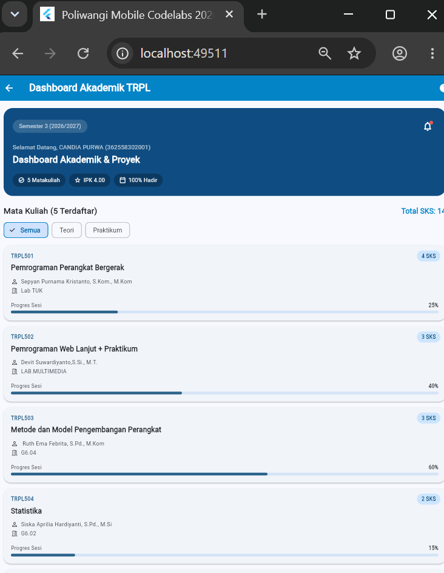
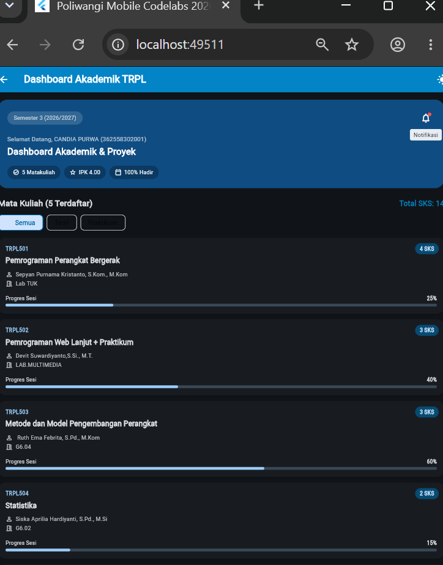
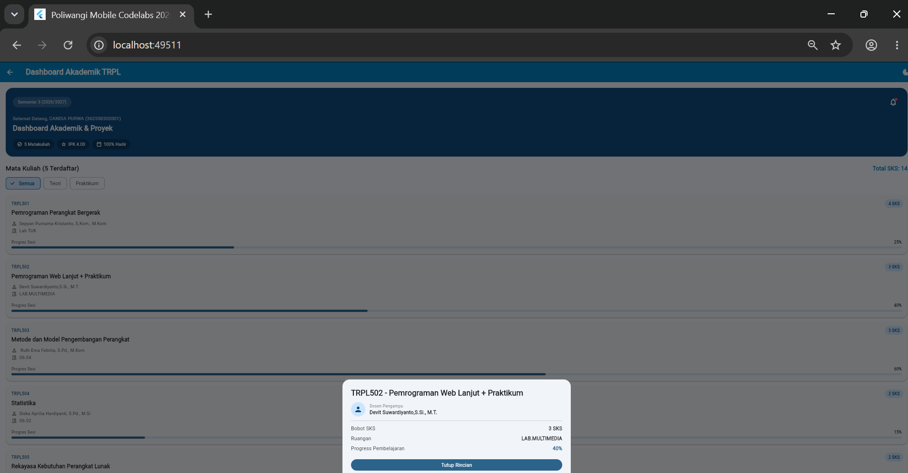
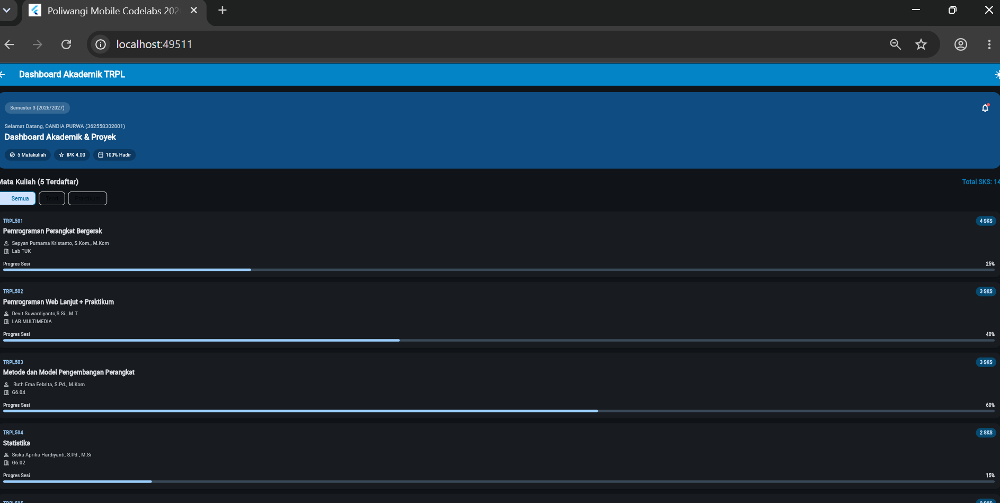

# Laporan Praktikum Modul 02: Declarative UI & Responsive Layout

- **Nama**: Candia Purwa
- **NIM**: 362558302001
- **Kelas / Prodi**: 2E / Sarjana Terapan TRPL D4
- **Mata Kuliah**: Pemrograman Perangkat Bergerak (Semester 3)

---

## 1. Ringkasan Implementasi
Dalam tugas praktikum ini, saya merancang sebuah dashboard akademik responsif dengan menerapkan widget LayoutBuilder sebagai pengatur tata letak utama. Melalui LayoutBuilder, aplikasi dapat membaca batasan ukuran layar (BoxConstraints) secara dinamis. Jika lebar layar mencapai atau melebihi 600 dp (seperti pada tablet atau mode landscape), layout akan otomatis berubah menjadi tampilan dua kolom yang menggabungkan banner profil di sisi kiri dan GridView untuk daftar mata kuliah di sisi kanan. Sebaliknya, pada layar ponsel (lebar di bawah 600 dp), tampilan akan menyesuaikan secara vertikal dalam satu kolom menggunakan ListView. Selain itu, antarmuka aplikasi dibangun menggunakan sistem Material 3 dengan memanfaatkan kustomisasi ThemeData terpusat, sehingga peralihan antara Light Mode dan Dark Mode dapat berjalan secara lancar dengan kontras warna yang tetap terjaga di seluruh komponen UI.

## 2. Bukti Tangkapan Layar (Running App)
| Mode Portrait (Light) | Mode Dark Theme | Mode Landscape / Tablet (2 Kolom) |
|---|---|---|
|  |  |  | | |

3. Kendala Layout yang Dihadapi & Solusinya
Teks Judul & Dosen Terpotong/Overflow
Kendala: Waktu dicoba di HP dengan layar sempit, nama mata kuliah yang panjang atau nama dosen sering bikin error RenderFlex overflowed (muncul garis kuning-hitam di layar).
Solusi: Teksnya dibungkus pakai Expanded atau dikasih batasan maxLines: 2 sama overflow: TextOverflow.ellipsis. Jadi kalau kepanjangan, otomatis berubah jadi titik-titik (...) di ujungnya dan tampilannya tetap rapi.
GridView Macet / Error Infinite Height di Tablet
Kendala: Pas ganti ke mode tablet (layar lebar), GridView yang ditaruh di dalam struktur scrollable malah bikin error karena tingginya nggak terbatas.
Solusi: Ngatur batasan tinggi kartu secara spesifik pakai mainAxisExtent: 240 pada SliverGridDelegateWithMaxCrossAxisExtent, terus GridView-nya dibungkus pakai Expanded supaya bisa ngisi sisa ruang secara responsif.
Filter Chip Offscreen di Layar Kecil
Kendala: Pilihan filter kategori ('Semua', 'Teori', 'Praktikum') kelihatan agak sesak dan berisiko kepotong kalau tombolnya makin banyak.
Solusi: Baris filter dibungkus pakai SingleChildScrollView dengan scroll arah horizontal, atau diatur jaraknya pakai Wrap dengan spacing yang pas biar fleksibel.

4. Jawaban Pertanyaan Refleksi
Efisiensi Single-pass BoxConstraints
Prinsip kerja Flutter itu pakai sistem single-pass (constraints go down, sizes go up, parent sets position). Maksudnya, Flutter cuma perlu ngitung dan ngukur ukuran tiap widget satu kali aja dari atas ke bawah. Nggak kaya sistem UI lama yang harus ngitung berulang-ulang (multi-pass), cara ini bikin proses rendering aplikasi jadi cepat banget dan tetep mulus di 60/120 FPS.
Kriteria Modularisasi Widget
Sebuah komponen UI lebih baik dipisah jadi widget tersendiri kalau memenuhi tiga hal ini:
Bisa dipakai ulang (Reusability): Komponennya muncul beberapa kali di tempat berbeda, contohnya CourseCard atau HeaderBanner.
Kodenya udah kepanjangan (Clean Code): Biar file utama nggak sampai ratusan baris dan pusing dibaca, komponen kecil dipecah ke file terpisah.
Manajemen State Lokal: Komponen punya logika sendiri (misal efek animasi atau tombol toggle) yang kalau berubah nggak perlu ngerender ulang seluruh isi halaman.
Manfaat M3 ThemeData Terpusat
Ngatur ThemeData langsung di pusat (file main.dart / root) punya dua keuntungan utama:
Tampilan Jadi Konsisten: Semua warna tombol, kartu, teks, sampai AppBar otomatis ngikut standar Material Design 3 tanpa perlu diatur manual satu-satu di tiap widget.
Gampang Bikin Dark Mode: Buat nerapin fitur mode gelap/terang, kita tinggal ubah atribut brightness-nya aja di root theme. Semua komponen di aplikasi bakal langsung menyesuaikan warnanya secara otomatis.