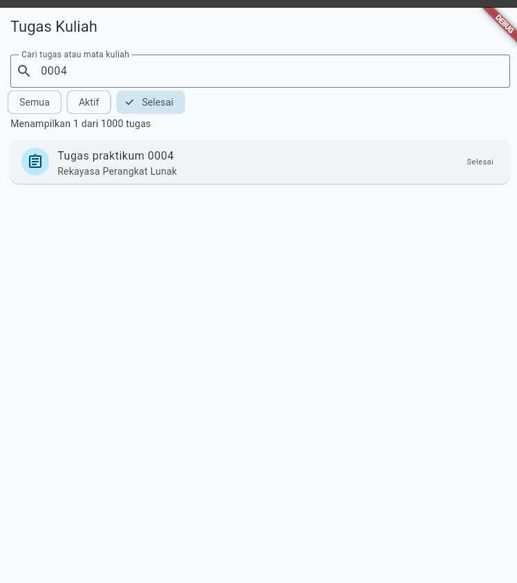
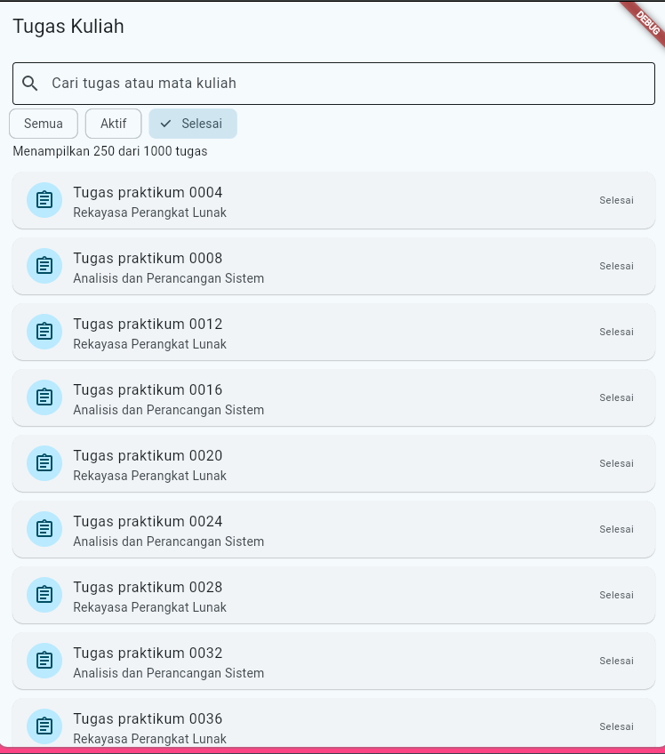
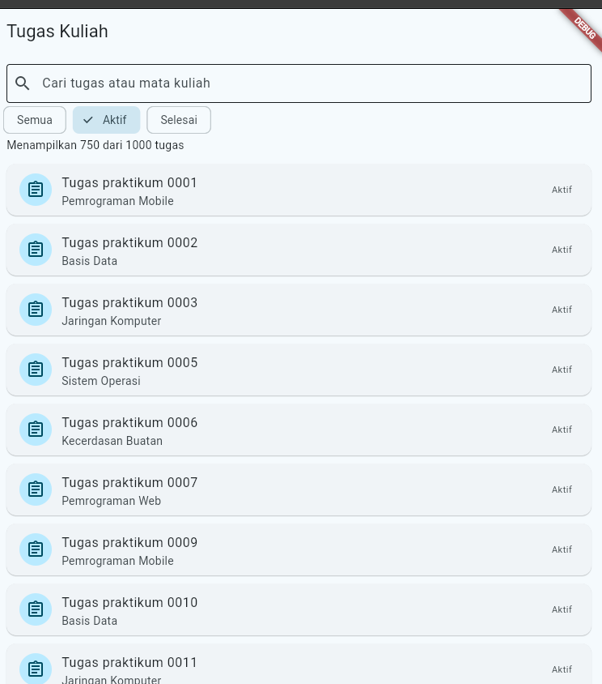
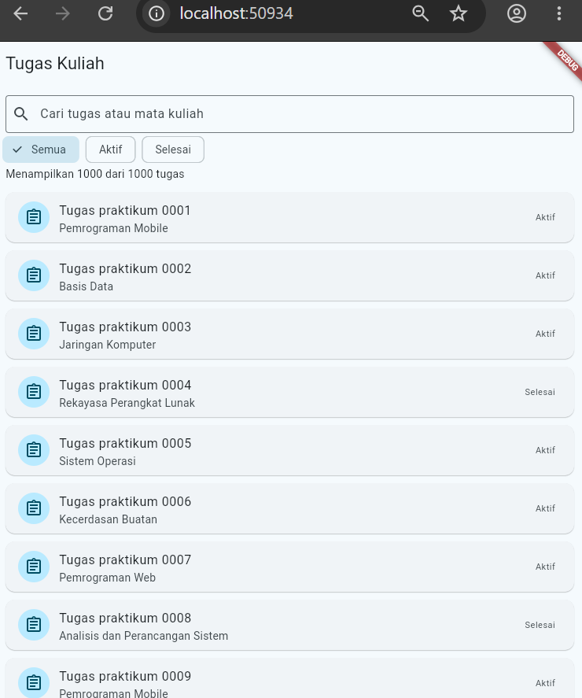
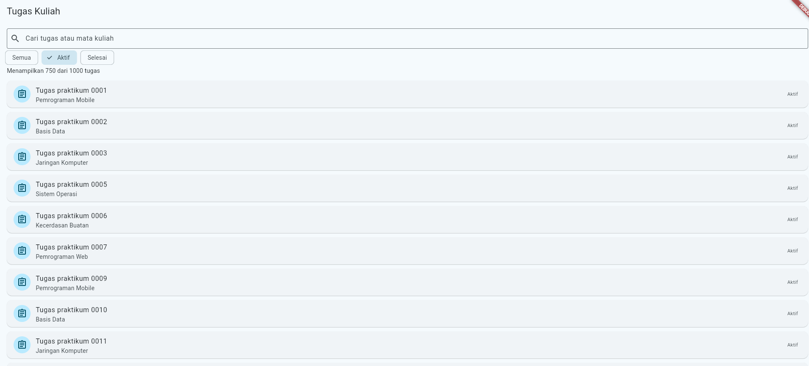
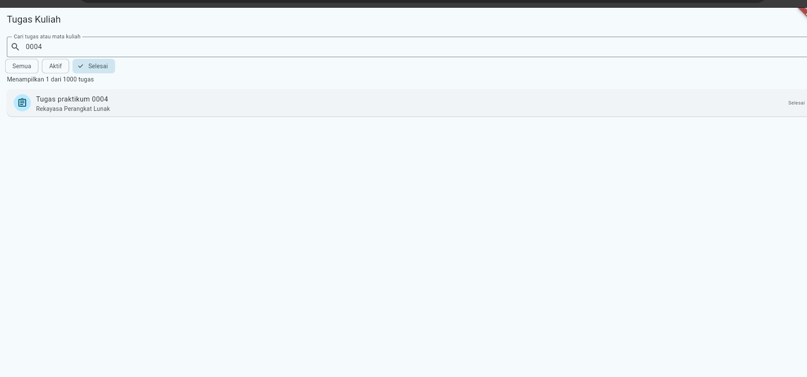
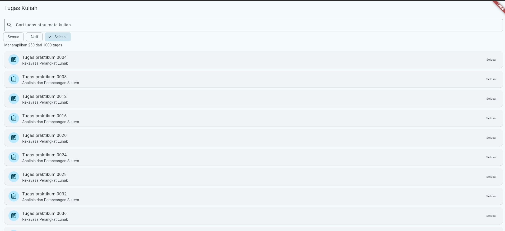
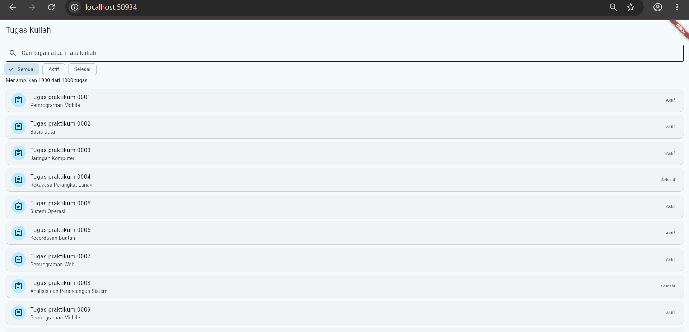
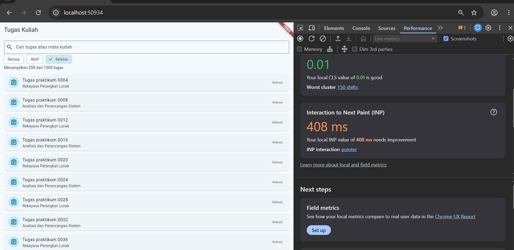

# Laporan Praktikum Modul 02: Declarative UI & Responsive Layout

- **Nama**: Candia Purwa
- **NIM**: 362558302001
- **Kelas / Prodi**: 2E / Sarjana Terapan TRPL D4
- **Mata Kuliah**: Pemrograman Perangkat Bergerak (Semester 3)

---

## 1. Ringkasan Implementasi
Berikut ringkasan inti dari materi dan percobaan Modul 11:
Tujuan Utama: Mengukur performa rendering UI (frame rate dan alokasi memori) serta membuktikan efisiensi pembuatan widget pada daftar data panjang.
Mekanisme Lazy Loading: Penggunaan ListView.builder memastikan hanya widget yang masuk area layar (viewport) yang dibangun, bukan seluruh 1.000 data sekaligus, sehingga mencegah animasi tersendat (jank).
Standar Pengukuran: Pengujian performa wajib dijalankan pada Profile Mode (flutter run --profile) menggunakan DevTools Performance view, karena Debug mode memiliki beban diagnostik yang membuat data frame tidak akurat.
Prinsip Optimasi: Memperbaiki bottleneck harus berbasis data ukur (profiling), seperti memakai ListView.builder untuk daftar panjang, menambahkan keyword const pada widget statis, dan membatasi proses komputasi berat di dalam method build().

## 2. Bukti Tangkapan Layar (Running App)
| Mode Portrait (Light) | Mode Dark Theme | Mode Landscape / Tablet (2 Kolom) |
|---|---|---|
|  |  |  | | | |  |  |  | | | | |

3. ### Pembahasan Modul 11: Efisiensi Data & List Rendering

#### 2. Data Sumber vs Hasil Penyaringan
* **Data Sumber:** `List.generate(1000, ...)` berfungsi sebagai master data mentah berisi 1.000 item tugas dengan status dari `enum StatusTugas`.
* **Hasil Penyaringan:** Getter `_hasil` mengolah data sumber secara dinamis dengan memfilternya berdasarkan kata kunci pada `_kueri` dan status yang dipilih pengguna.

#### 3. Mekanisme `ListView.builder` & Pengujian
* Menggunakan `itemCount: _hasil.length` dan widget `_KartuTugas`.
* **Hasil Uji (`flutter test test/modul_11_test.dart`):** Pengujian membuktikan konsep *lazy loading* berjalan sukses. Dari total 1.000 data, sistem hanya me-render beberapa kartu yang terlihat di layar (*viewport*) saat awal dibuka, sehingga penggunaan memori tetap efisien.

#### 4. Verifikasi Skenario Pengguna
* **Pencarian spesifik (`praktikum 0002`):** Berhasil memfilter daftar hingga menampilkan tepat **1 data**.
* **Filter status `Selesai`:** Menampilkan tepat **250 data** (sesuai logika modulo 4 pada data generator).
* **Reset/Bersihkan pencarian:** Daftar kembali normal menampilkan seluruh 1.000 data.

#### 5. Profiling Performa (Profile Mode)
* **Perangkat/Emulator:** [Isi sesuai perangkat Anda, misal: *Pixel 6 API 34 Emulator* / *Redmi Note 10 Pro*]
* **Mode:** `flutter run --profile`
* **Tindakan:** Menggulir cepat (*fast scroll*) pada 1.000 data dan mengetik kata kunci pencarian.
* **Hasil DevTools (Performance View):** UI thread stabil di kisaran 60–120 fps. Tidak ditemukan *jank* atau frame lambat yang signifikan saat *scrolling* berkat implementasi `ListView.builder`.

#### 6. Optimasi Widget & Pengukuran Ulang
* **Perubahan Kode:** Menambahkan konstruktor `const` pada widget statis di dalam `_KartuTugas` (seperti `Icon`, `SizedBox`, dan styling teks tetap).
* **Hasil Pengukuran:** Tidak terukur pada skenario ini. Beban render item kartu relatif ringan sehingga alokasi memori dan waktu render per-frame tidak menunjukkan selisih angka yang signifikan di DevTools.
