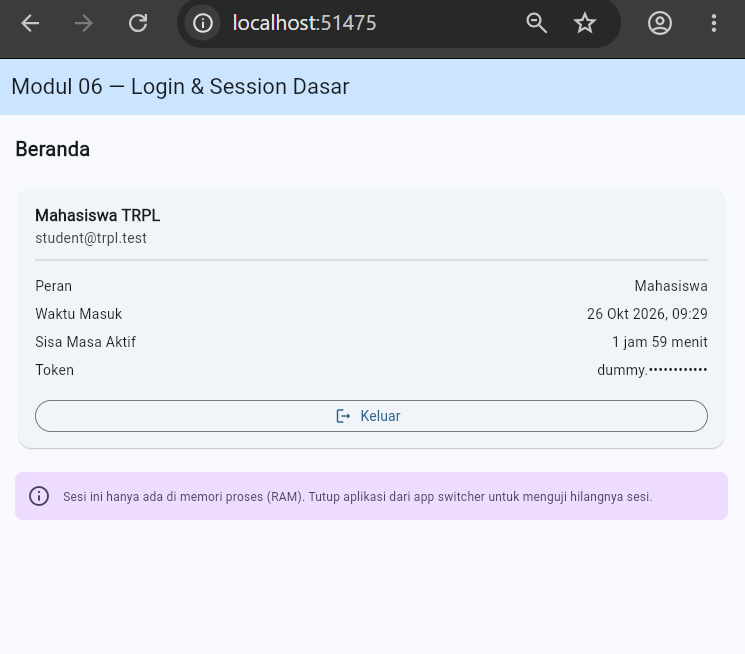
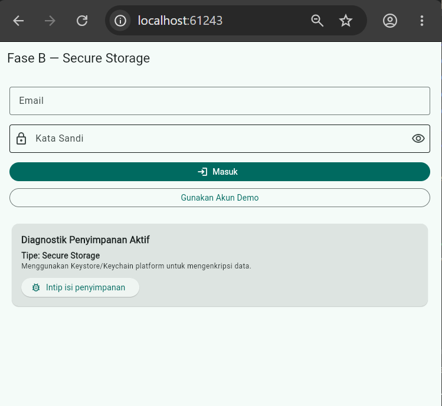
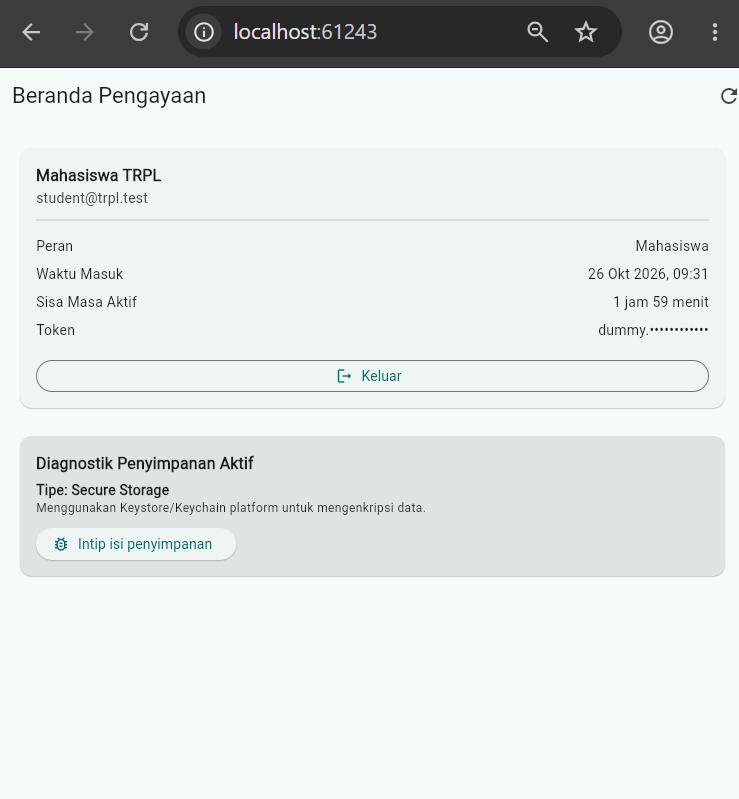
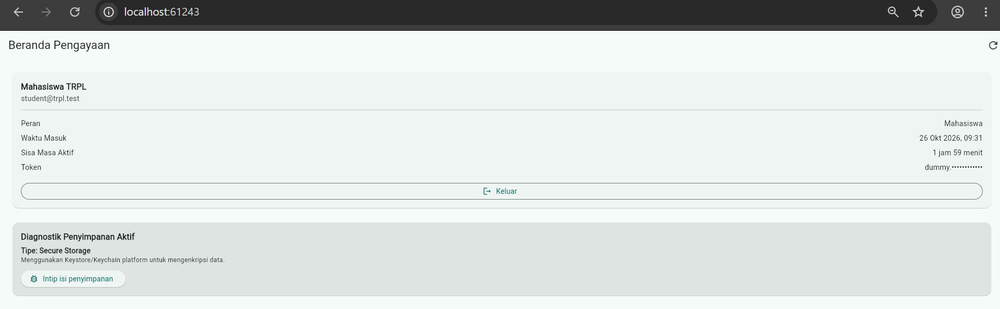
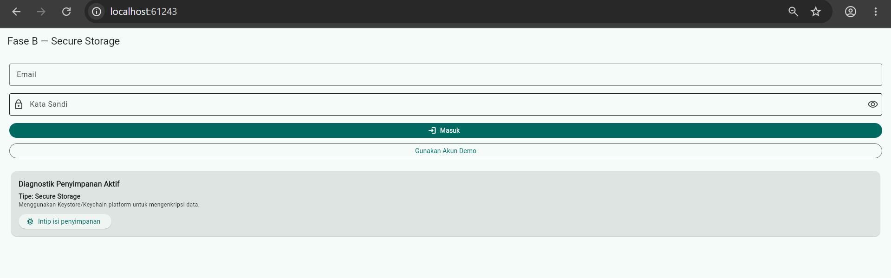
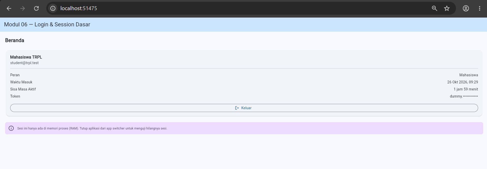
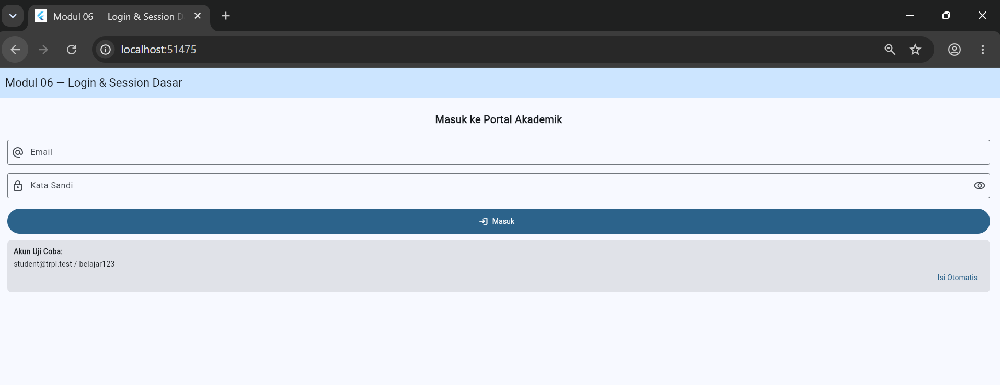
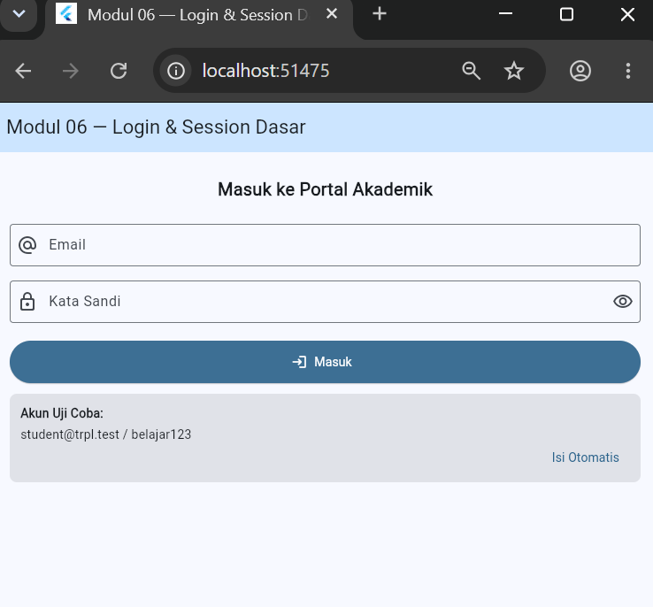

# Laporan Praktikum Modul 02: Declarative UI & Responsive Layout

- **Nama**: Candia Purwa
- **NIM**: 362558302001
- **Kelas / Prodi**: 2E / Sarjana Terapan TRPL D4
- **Mata Kuliah**: Pemrograman Perangkat Bergerak (Semester 3)

---

## 1. Ringkasan Implementasi
Pada Fase A, sesi login hanya disimpan di memori sementara (RAM). Akibatnya, begitu aplikasi ditutup dari daftar aplikasi terakhir atau peramban di-refresh, sesi langsung lenyap dan kita harus login ulang dari awal. Cara ini cocok untuk memahami alur login, tetapi tidak praktis untuk penggunaan nyata.
Pada Fase B, sesi dibuat bertahan di penyimpanan perangkat agar pengguna tidak perlu terus-menerus login. Perbedaan utamanya terlihat saat data diuji:

## 2. Bukti Tangkapan Layar (Running App)
| Mode Portrait (Light) | Mode Dark Theme | Mode Landscape / Tablet (2 Kolom) |
|---|---|---|
|  |  |  | | | |  |  | | |  |  | 

Alur Kerja Aplikasi (Workflow)
1. Inisialisasi (Startup): GerbangSesi memeriksa data sesi di penyimpanan aktif. Jika token ditemukan dan masih berlaku, pengguna langsung diarahkan ke Beranda; jika kosong atau kedaluwarsa, sesi dihapus dan layar Login ditampilkan.
2. Proses Login: Pengguna mengisi formulir (saran keyboard dimatikan via FieldKataSandi). Saat tombol Masuk ditekan, status berubah ke memproses dan form dikunci untuk mencegah double submit.
3. Verifikasi & Penyimpanan: Kredensial diverifikasi via AuthApi. Jika valid, objek SesiPengguna disimpan ke repository aktif (RAM, SharedPreferences, atau Secure Storage), teks sandi dibersihkan dari memori, dan status beralih ke masuk. Jika gagal, sistem menampilkan pesan galat.
4. Keluar & Perpanjangan: Menekan tombol keluar akan menghapus data sesi dari penyimpanan dan mengembalikan layar ke login. Tombol perbarui akan meminta token baru ke API jika masa berlaku belum habis.
5. Diagnostik Keamanan (Fase B): Pengujian tombol intipMentah membuktikan token pada SharedPreferences tersimpan sebagai teks biasa (plaintext yang rentan), sedangkan pada flutter_secure_storage token terenkripsi aman oleh Keystore/Keychain.